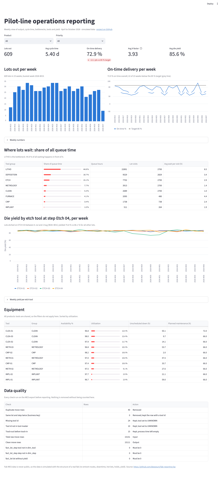

# Pilot-Line Fab Reporting: a business analysis project

**Live dashboard: [fab-reporting-ba.streamlit.app](https://fab-reporting-ba.streamlit.app)**

An end-to-end reporting solution for a semiconductor pilot line, run the way a reporting business analyst works: from the business problem and stakeholder requirements, through KPI definitions, a Kimball star schema and automated data-quality checks, to SQL analysis, a tested Streamlit dashboard and a Power BI model.

[](https://fab-reporting-ba.streamlit.app)

> **Data note:** fab MES data is never public, so the operational data is **simulated** (`python/01_generate_pilot_line_data.py`) with the structure of a real fab: re-entrant routes, tool groups, planned and unscheduled downtime, hot lots, holds and lot yield. The source export also contains deliberate data-quality problems, which the pipeline has to catch.

## What the analysis found

| Finding | Evidence |
|---------|----------|
| **Lithography is the bottleneck.** It causes 45 % of all lot waiting time, at 75 % utilization (next highest tool group: 51 %). | `sql/03_kpi_queries.sql` Q2, Q3 |
| **Yield excursion on ETCH-03 at step Etch 04.** Lots etched there between 6 Jul and 2 Aug yielded **75.8 %** vs **86.1 %** for all other lots, while the other three etch tools stayed normal. | Q4, Q5 |
| **On-time delivery is 72.9 %** against an 85 % target, with an average X-factor of 3.9: lots spend most of their time waiting, not processing. Litho is the largest single share of that waiting. | Q1, Q2 |
| **The source export had 89 bad rows** (duplicates, unknown tools, impossible timestamps). All are logged on the dashboard; none are silently dropped. | `data/clean/dq_report.csv` |

**Recommendations to the pilot-line team:** (1) protect litho capacity first, e.g. schedule maintenance outside peak arrival days and give it priority staffing, since every hour gained there shortens cycle time for every lot; (2) put ETCH-03 on Etch 04 under review and add a weekly per-tool yield check at that step, so the next drift is caught within a week; (3) fix the MES export at the source for missing tool ids and timestamp errors.

## How the project follows the BA process

| Stage | Deliverable |
|-------|-------------|
| 1. Understand the business | [Business brief](docs/01_business_brief.md): problem statement, measurable objectives, stakeholder map, scope, user stories with acceptance criteria |
| 2. Agree definitions | [KPI dictionary](docs/02_kpi_dictionary.md): 12 KPIs with formula, owner, target, plus business rules |
| 3. Design the data | [Data model](docs/03_data_model.md): Kimball star schema, grain of each table, source-to-target mapping |
| 4. Build and check the data | [`02_clean_and_build_star_schema.py`](python/02_clean_and_build_star_schema.py): data-quality rules, unknown members, periodic snapshot fact |
| 5. Answer the questions | [`03_kpi_queries.sql`](sql/03_kpi_queries.sql): CTEs, window functions, moving averages, step-level yield analysis |
| 6. Report | [Streamlit dashboard](streamlit_app.py) ([live](https://fab-reporting-ba.streamlit.app)): KPI tiles, product and priority filters, bottleneck, yield and equipment views, data-quality page; and the [Power BI model](powerbi/): relationships and [DAX measures](powerbi/measures.dax), incl. semi-additive WIP and time intelligence |
| 7. Test and release | [Test plan](docs/04_test_plan.md): data tests, dashboard vs SQL reconciliation, UAT script |

## Repository

```
python/01_generate_pilot_line_data.py    simulated MES export -> data/raw/
python/02_clean_and_build_star_schema.py data-quality checks + star schema -> data/clean/
streamlit_app.py                         the dashboard (reads data/clean/)
sql/01..03                               PostgreSQL schema, load script, KPI queries
powerbi/                                 DAX measures and Power BI model guide
docs/                                    business brief, KPI dictionary, data model, test plan
```

## Run it

```bash
pip install -r requirements.txt
python python/01_generate_pilot_line_data.py
python python/02_clean_and_build_star_schema.py
streamlit run streamlit_app.py

# PostgreSQL
createdb fab_reporting
psql -d fab_reporting -f sql/01_create_star_schema.sql
psql -d fab_reporting -f sql/02_load_csv.sql
psql -d fab_reporting -f sql/03_kpi_queries.sql
```

## Tools

Python (pandas, NumPy) · PostgreSQL · SQL · Streamlit · Power BI (DAX) · GitHub

## Possible extensions

- Sensor-to-yield analysis with the public UCI SECOM semiconductor data set
- Expected finish date per lot for partner managers (user story US-07)
- A Tableau version of the same model
