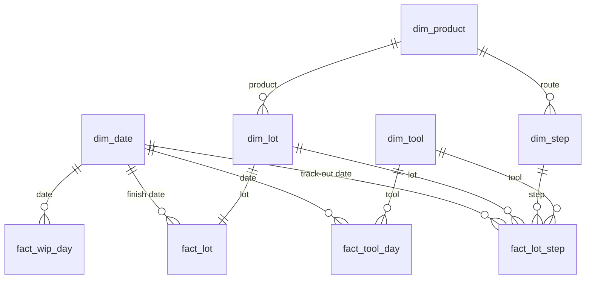

# Data model

A star schema (Kimball): dimension tables describe *things*, fact tables record *what happened*. Each fact table has one clear grain, which is the first thing to agree with stakeholders, because it decides which questions the model can answer.

| Table | Grain (one row = ...) | Rows |
|-------|-----------------------|-----------|
| `fact_lot_step` | one lot at one process step | 15,111 |
| `fact_lot` | one finished lot | 609 |
| `fact_tool_day` | one tool on one day | 3,297 |
| `fact_wip_day` | one tool group at end of one day | 906 |
| `dim_date` | one calendar day | 157 |
| `dim_lot` | one lot | 609 |
| `dim_step` | one step in one product route | 73 |
| `dim_tool` | one tool (+ `UNKNOWN`) | 22 |
| `dim_product` | one product | 3 |

## Design choices

- **`UNKNOWN` tool member.** Source rows without a valid tool still count for lot KPIs, but never inflate a real tool's numbers.
- **`fact_wip_day` is a periodic snapshot.** WIP is a level, not an event, so it is stored per day rather than calculated live from millions of moves.
- **Targets live in `dim_product`.** A target change is a data change, not a report change.
- **`dq_flag` stays on the fact rows.** Flagged rows can be filtered in or out and are always traceable.

## Source to target

| Source (MES export) | Check | Target |
|---------------------|-------|--------|
| `lot_moves.csv` | duplicates, business key, tool in master, timestamp order | `fact_lot_step`, `fact_lot`, `fact_wip_day` |
| `lots.csv` | — | `dim_lot`, `fact_lot` |
| `lot_yield.csv` | every lot has a yield | `fact_lot` |
| `tool_events.csv` | events split per calendar day | `fact_tool_day` |
| `tools.csv`, `products.csv`, `routes.csv` | — | dimensions |
