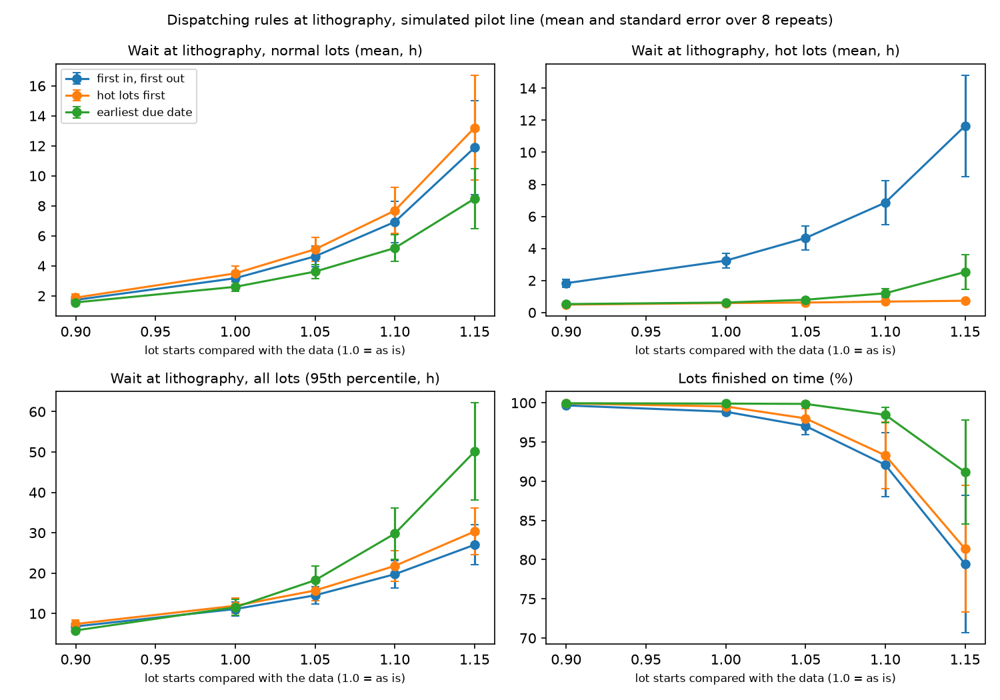
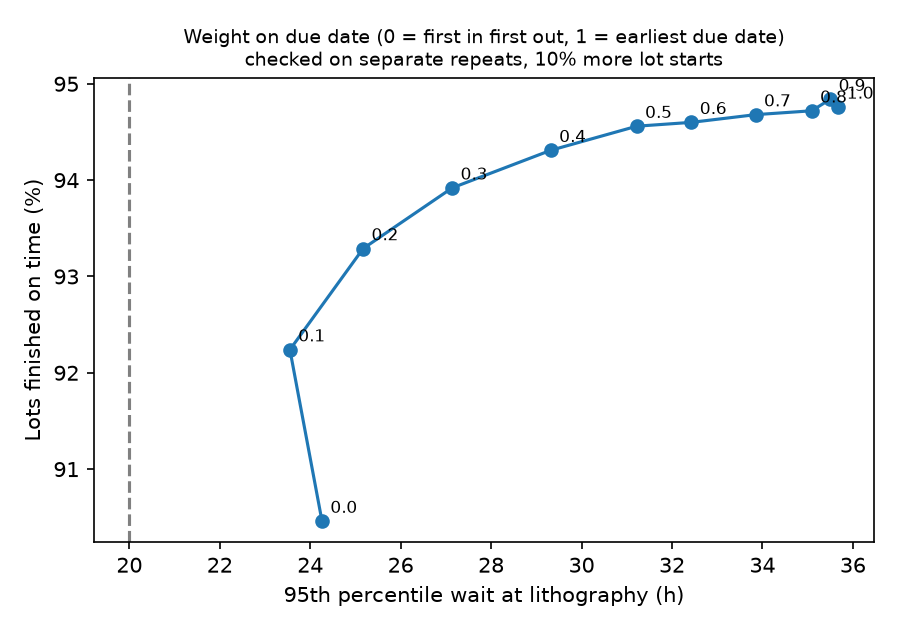

# Dispatching rules at lithography: a queue simulation of the pilot line

**Data type:** simulated. The pilot line in this repo is itself simulated, so this is a simulation of a simulated line.

When several lots wait for the same tool group, which lot should go first, and does the answer change when the line gets busier? `dispatch_simulation.py` is a small queue simulation (SimPy) built to answer that for the lithography step, the bottleneck of this pilot line.

## How it works

The model reads the repo's own data: the routes, the number of tools per group, the process time of each group (mean and spread, from the clean table), about four lot starts per day, the product mix, the share of hot lots, holds, transport time and the tool down events. Lots arrive at random, follow their route and wait in one queue per tool group until a tool is free. A dispatching rule decides which waiting lot goes next. Every rule is tested on exactly the same lots, so the differences come from the rule and not from luck.

Simplifications: lots of a tool group share one queue; a tool that is due for maintenance or a breakdown goes down when it is next free; process times are normal; transport time is constant; the down events are the ones in the data.

## Check against the data

| Tool group | Utilization, data | Utilization, simulation | Wait (h), data | Wait (h), simulation |
|---|---|---|---|---|
| LITHO | 75.3 % | 81.0 % | 8.5 | 4.0 |
| DEPOSITION | 50.6 % | 51.3 % | 3.4 | 0.2 |
| FURNACE | 26.1 % | 26.3 % | 4.4 | 0.2 |
| ETCH | 22.0 % | 22.1 % | 2.9 | 0.0 |

(All eight groups are in `results/check_against_data.csv`.) Utilization matches within one point for every group except lithography. There, about 390 of the 5,930 hours of lithography work in the data fall after the last day of the tool-day table, because lots in the data take longer to finish; in the simulation almost all of that work falls inside.

Waiting times do not match, and this is expected. The generator draws each queue time from a fixed average per tool group, so queues in the data do not respond to capacity. In the simulation a lot waits only when all tools of its group are busy. Cycle time is 2.7 days against 5.4 in the data, and 97.8 % of lots are on time against 72.9 %. Both agree that lithography is the bottleneck. The simulation is therefore used to compare rules and loads with each other, not to reproduce the data's waiting times.

## Three dispatching rules

At 10 % more lot starts than in the data:

| Rule | Normal lots wait (h) | Hot lots wait (h) | 95th percentile wait (h) | Lots on time |
|---|---|---|---|---|
| First in, first out | 6.9 | 6.9 | 19.7 | 92.1 % |
| Hot lots first | 7.7 | 0.7 | 21.8 | 93.3 % |
| Earliest due date | 5.2 | 1.2 | 29.8 | 98.5 % |

When the line is not busy, waits are short whatever the rule. As load rises, waiting grows quickly for every rule. Hot lots first protects the hot lots at the cost of the normal ones. Earliest due date finishes the most lots on time, but the longest waits get longer, because lots with a late due date are pushed back.



## A small search: how much weight on the due date?

A mix of the first two time-based rules has one knob: 0 is first in, first out, 1 is earliest due date. I set the goal before looking at results: the most lots on time, with a 95th percentile wait of at most 20 hours, at 10 % more lot starts. The weight was chosen on one set of repeats and checked on another. Weight 0.1 was chosen.

Compared with first in, first out on 16 new repeats with the same lots, weight 0.1 finishes 3.8 points more lots on time (95 % interval +2.8 to +4.8) and changes the 95th percentile wait by -0.3 hours (interval -0.8 to +0.2). The 20 hour limit held on the repeats used to choose (19.4 h) but not on the separate ones (23.6 h), where first in, first out also misses it (24.3 h). The comparison on the same lots is the reliable result.



## Limits

- One bottleneck is studied; setups, batching and lot priority changes along the route are not modelled.
- Eight repeats per setting; process times are normal; the line is simulated, so the results describe this model, not a real fab.
- It is a small what-if simulation, not a digital twin.

## Run it

```
pip install -r simulation/requirements.txt
python simulation/dispatch_simulation.py
```

It takes a couple of minutes and writes the tables and charts to `simulation/results/`.
